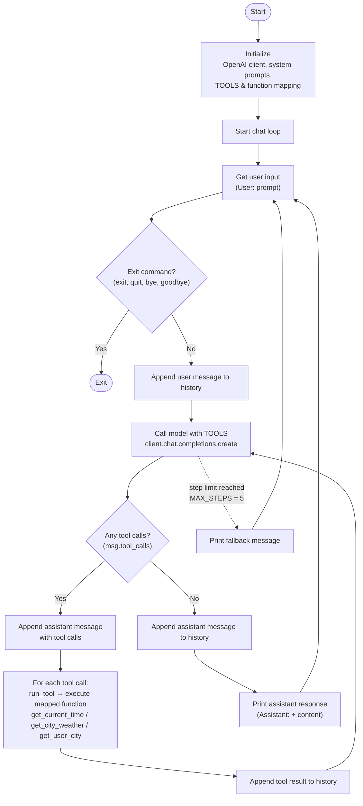

# Simple AI Assistant

A minimal command-line AI assistant that chats from your terminal and can call
real tools (time, weather, your location) to answer questions. It talks to any
OpenAI-compatible chat API — by default a local [Ollama](https://ollama.com)
server running the `qwen3:4b` model, so it runs fully offline with no API costs.

## Features

- **Interactive chat loop** — type questions, get answers, until you say `exit`.
- **Tool calling** — the model decides when to call a tool and the assistant runs it:
  - `get_current_time` — current date/time for any IANA timezone.
  - `get_city_weather` — current weather for a city (via [wttr.in](https://wttr.in)).
  - `get_user_city` — the user's home city, for "weather at my place"-style questions.
- **Chained tool calls** — the model can call several tools across up to
  `MAX_STEPS` (5) rounds to resolve one question (e.g. look up your city, then
  fetch its weather).
- **Debug logging** — set `DEBUG=True` to see tool calls and results in gray.
- **Provider-agnostic** — point it at any OpenAI-compatible endpoint by editing `.env`.

## Project structure

```
Simple AI Assistant/
├── simple_ai_assistant.py   # Entry point: chat loop + tool-calling orchestration
├── tools.py                 # Tool definitions, implementations, and dispatch
├── Utilities/
│   └── utilities.py         # Debug logging helper
└── .env                     # Configuration (not committed)
```

## Requirements

- Python 3.11+ (developed on 3.14)
- An OpenAI-compatible chat endpoint. The default config expects
  [Ollama](https://ollama.com) running locally.

Python dependencies:

- `openai`
- `python-dotenv`
- `requests`

## Setup

1. **Clone and enter the project**

   ```bash
   cd "Simple AI Assistant"
   ```

2. **Create a virtual environment and install dependencies**

   ```bash
   python3 -m venv .venv
   source .venv/bin/activate
   pip install openai python-dotenv requests
   ```

3. **Start Ollama and pull the model** (for the default local setup)

   ```bash
   ollama pull qwen3:4b
   ollama serve
   ```

4. **Create a `.env` file** in the project root:

   ```ini
   BASE_URL=http://127.0.0.1:11434/v1
   API_KEY=dummy_key
   MODEL=qwen3:4b
   DEBUG=True
   ```

   | Variable   | Description                                                        |
   |------------|--------------------------------------------------------------------|
   | `BASE_URL` | Base URL of the OpenAI-compatible API.                             |
   | `API_KEY`  | API key. Any non-empty value works for local Ollama.              |
   | `MODEL`    | Model name to use for completions.                                 |
   | `DEBUG`    | Set to `True` to print tool calls and results; anything else off. |

## Usage

```bash
python simple_ai_assistant.py
```

Then chat at the prompt:

```
User: what time is it in London?
Assistant: It's 2026-10-20 20:15:03 BST in London.

User: how's the weather where I live?
Assistant: Los Angeles: ☀️ +24°C

User: exit
Exiting the assistant. Goodbye!
```

Type `exit`, `quit`, `bye`, or `goodbye` to leave.

## Control flow



The model/tool loop (`Call model` → `Any tool calls?` → run tools → call again) repeats
up to `MAX_STEPS` (5) times per user question. If the model never returns a plain
answer within that budget, the assistant prints a fallback message and waits for the
next input.

## How it works

1. User input is appended to the running `messages` history.
2. The assistant sends the conversation plus the `TOOLS` schema to the model.
3. If the model requests tool calls, each is dispatched through `run_tool`
   (`tools.py`), and the results are appended to the history.
4. Steps 2–3 repeat until the model returns a plain answer, or until
   `MAX_STEPS` (5) rounds are used — after which it returns a fallback message.
5. The final answer is printed and kept in history for context.

The system prompts keep replies in English and under 10 words — tweak them at
the top of `simple_ai_assistant.py` to change the assistant's behavior.

## Adding a new tool

1. Write the function in `tools.py`.
2. Add its JSON schema to the `TOOLS` list.
3. Register it in `FUNCTION_NAME_TO_FUNCTION_MAP`.

The assistant will then be able to call it automatically when relevant.

## Notes

- `get_user_city` is hard-coded to `"Los Angeles"` — edit it in `tools.py` to
  set your own city.
- `.env` holds configuration and should not be committed to version control.
```

